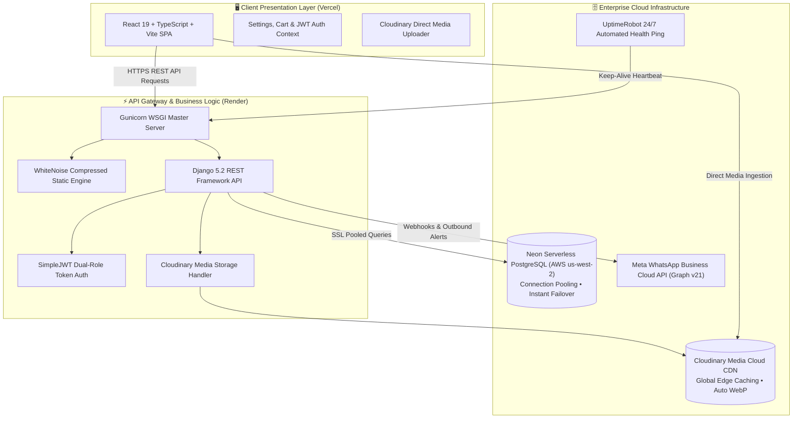

<div align="center">

  

  # 🎂 FRESH CAKE by PROVA
  ### Commercial Client Production Platform & Bakery ERP Ecosystem
  
  **A Custom-Engineered Full-Stack Artisan Bakery, Interactive Custom Cake Builder & Operations Management System**

  [](https://github.com/ripro805/fresh-cake-by-prova)
  [](https://fresh-cake-by-prova-backend.onrender.com/)
  [](https://react.dev/)
  [](https://www.typescriptlang.org/)
  [](https://www.djangoproject.com/)
  [](https://neon.tech/)
  [](https://cloudinary.com/)
  [](https://fresh-cake-by-prova-backend.onrender.com/)

  <p align="center">
    <a href="https://fresh-cake-by-prova-backend.onrender.com/"><strong>Explore Live Backend API »</strong></a>
    &nbsp;•&nbsp;
    <a href="https://fresh-cake-by-prova-backend.onrender.com/api/docs/"><strong>Swagger API Docs »</strong></a>
    &nbsp;•&nbsp;
    <a href="https://github.com/ripro805/fresh-cake-by-prova"><strong>GitHub Repository »</strong></a>
  </p>

</div>

---

## 💼 Client & Commercial Engagement Overview

| Metric | Project Specification |
| :--- | :--- |
| **Client** | **PROVA Artisan Studio & Patisserie** (Kushtia, Khulna Division, Bangladesh) |
| **Industry** | Gourmet Bakery, Customized Celebration Cakes & Quick-Service Patisserie |
| **Engagement Scope** | End-to-End Bespoke Commercial Development (UI/UX Branding, Full-Stack Architecture, Real-Time Cake Quotation Studio, WhatsApp CRM, and Back-Office ERP) |
| **Delivery Model** | Paid Commercial Commission |
| **Lead Engineer & Architect** | **Md. Rifat Islam Rizvi** (AI/ML + Full-Stack Builder) |
| **Contact Email** | `freshcakebyprova.official@gmail.com` |
| **Production Support** | WhatsApp & Phone: `+8801305612767` |

---

## 🎯 The Client Challenge & Strategic Objectives

Before commissioning this platform, **PROVA Artisan Studio** faced severe operational bottlenecks common to rapidly growing artisan confectioneries:

1. **Unstructured Custom Cake Ordering**: Customers ordered complex multi-tiered customized cakes through scattered WhatsApp voice notes, Facebook messages, and in-person visits, leading to design misunderstandings, flavor mismatch, and pricing inconsistencies.
2. **Payment & Reconciliation Friction**: High rates of unverified bKash/Nagad mobile banking transactions without automated TrxID matching caused reconciliation delays.
3. **Raw Ingredient Spoilage & Stockouts**: High-cost imported ingredients (Belgian couverture chocolate, French whipping cream, pure vanilla bean paste) were tracked manually, causing unexpected ingredient stockouts during wedding seasons.
4. **Order Status Anxiety**: Customer service was inundated with "When will my cake arrive?" calls on celebration mornings, demanding an automated, transparent real-time tracking pipeline.

---

## 💡 Engineered Solutions & Enterprise Features

### 🍰 1. Artisan Consumer Storefront
* **Interactive 4-Step Custom Cake Studio**:
  * Step 1: Occasion selection (Wedding, Birthday, Anniversary, Corporate) & weight tiers (1 to 5+ lbs).
  * Step 2: Flavor, filling & sponge profiling (Red Velvet, Belgian Truffle, Lotus Biscoff, Caramel Pistachio).
  * Step 3: Aesthetic color palette selection & direct customer inspiration photo uploads powered by **Cloudinary CDN**.
  * Step 4: Delivery scheduling (exact date & time slots) with dynamic venue delivery fee calculation.
* **Multi-Category Catalog**: Instant reactive filtering across *Celebration Cakes*, *Brioche Donuts*, *Steamed Momos*, and *Artisan Tub Cakes* with variant price switching and dietary indicators.
* **Persistent Drawer Cart & Checkout**:
  * Real-time coupon engine with discount deductions.
  * Localized delivery fee computation (*Inside Kushtia Town: ৳50*, *Outside Delivery Zones: ৳150*, *Studio Pickup: ৳0*).
  * Multi-method payment capture (bKash Personal/Merchant, Nagad, Cash on Delivery) with transaction validation.
* **Chronological Order Tracker**: Customers inspect live milestones: *Order Placed* → *Confirmed* → *Baking in Progress* → *Quality Check* → *Out for Delivery* → *Delivered*.

### 💬 2. Dual-Engine WhatsApp CRM & Support
* **One-Click WhatsApp Deep Integration**:
  * Automated international number formatting (`8801305612767`) ensuring zero redirect failures.
  * Pre-populated inquiry messages for every product, custom cake quote, and tracking receipt.
* **In-Website Live Ticket Sync**:
  * Dedicated customer support chat modal with auto-generated reference tickets (e.g. `Ticket: FC-6436`).
  * Seamless handover to WhatsApp with a single tap.
  * Built-in Django webhooks for Meta WhatsApp Cloud API bidirectional sync.

### 🏢 3. Enterprise Owner ERP & Admin Portal
* **Financial Ledger & Profitability**:
  * Real-time revenue tracking, gross sales, net margins, and operational expenditure logging.
  * Categorized business expenses (raw materials, utilities, packaging, rider delivery fees).
* **Dual-Tier Inventory Engine**:
  * Finished retail goods inventory with batch stock counts.
  * Raw bakery ingredient tracking with low-stock threshold triggers.
* **Order Fulfillment Dispatcher**:
  * Interactive status toggles that trigger automatic customer WhatsApp status updates.
  * Custom cake quote review with pricing adjustment and direct quotation approvals.
* **Audit Trail**:
  * Immutable event logging tracking every administrative configuration, status change, and payment verification.

---

## 🏗️ System Architecture & Data Topology



---

## 🛠️ Technology Stack & Infrastructure

| Layer | Technologies & Tools |
| :--- | :--- |
| **Frontend Framework** | **React 19**, **TypeScript 5.x**, **Vite 6.x** |
| **Styling & Design System** | Custom Artisan Design Tokens, Tailwind CSS, Lucide Icons, Canvas Confetti |
| **Backend Framework** | **Python 3.14**, **Django 5.2**, **Django REST Framework 3.18** |
| **Database & ORM** | **Neon Serverless PostgreSQL (v18)** with Connection Pooling & SSL |
| **Media & Asset CDN** | **Cloudinary Cloud Media Storage** (`django-cloudinary-storage`) |
| **Authentication & RBAC** | SimpleJWT with custom claims (Unified Phone/Email Login, `OWNER_ADMIN` vs `CUSTOMER`) |
| **API Documentation** | **drf-spectacular** (OpenAPI 3.0, Swagger UI & Redoc) |
| **Hosting & Deployment** | **Render** (Backend API), **Vercel** (Frontend SPA), **UptimeRobot** (Monitoring) |

---

## 🔐 Administrative Access & Credentials

The platform is equipped with an authenticated **Owner Admin Portal** for day-to-day bakery operations:

* **Admin Portal URL**: `/login` (redirects automatically to `/admin` upon Owner login)
* **Owner Admin Identifier**: `freshcakebyprova.official@gmail.com`
* **Owner Phone**: `01305612767`
* **Official Contact**: `freshcakebyprova.official@gmail.com`
* **Direct Studio WhatsApp**: `+8801305612767`

---

## 🚀 Local Development Setup

### 1. Repository Clone
```bash
git clone https://github.com/ripro805/fresh-cake-by-prova.git
cd fresh-cake-by-prova
```

### 2. Frontend Configuration
```bash
# Install frontend dependencies
npm install

# Run Vite development server
npm run dev
```

### 3. Backend Setup
```bash
cd backend

# Create & activate virtual environment
python -m venv venv
# On Windows:
.\venv\Scripts\activate
# On Unix/macOS:
source venv/bin/activate

# Install requirements
pip install -r requirements.txt

# Configure environment variables (.env)
cp .env.example .env

# Run database migrations
python manage.py migrate

# Start Django development server
python manage.py runserver
```

---

## 👨‍💻 Lead Software Engineer & Architect

<div align="center">

  

  ### **Md. Rifat Islam Rizvi**
  *AI/ML + Full-Stack Builder*  
  **Gopalganj Science and Technology University**  
  *B.Sc. in Computer Science and Engineering (CSE)*  
  📍 Kushtia, Bangladesh

  [](https://github.com/ripro805)
  [](https://www.linkedin.com/in/md-rifat-islam-rizvi-a481682b1/)
  [](https://www.facebook.com/ripro.805/)
  [](mailto:rifatrizviofficial001@gmail.com)

</div>

---

## 📄 License & Commercial Rights

This software is licensed under the [MIT License](LICENSE) with all proprietary branding, trademark imagery, and bakery commercial assets reserved by **PROVA Artisan Studio**.

*Engineered with precision, luxury aesthetics, and robust full-stack architecture for FRESH CAKE by PROVA.*
