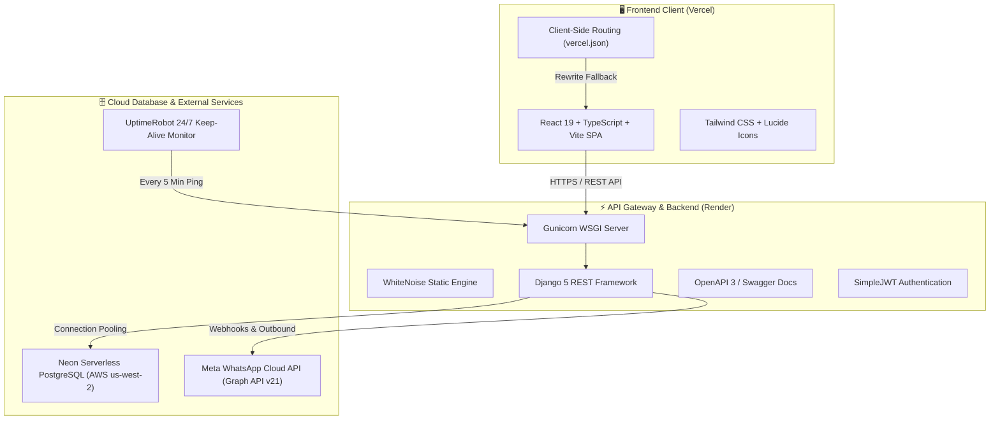

<div align="center">

  

  # 🎂 FRESH CAKE by PROVA
  
  **A Next-Generation Full-Stack Artisan Bakery & Custom Cake E-Commerce Platform**

  [](https://react.dev/)
  [](https://www.typescriptlang.org/)
  [](https://vitejs.dev/)
  [](https://www.djangoproject.com/)
  [](https://www.django-rest-framework.org/)
  [](https://neon.tech/)
  [](https://fresh-cake-by-prova-backend.onrender.com/)
  [](https://vercel.com/)
  [](LICENSE)

  <p align="center">
    <a href="https://fresh-cake-by-prova-backend.onrender.com/"><strong>Explore Live API »</strong></a>
    &nbsp;•&nbsp;
    <a href="https://fresh-cake-by-prova-backend.onrender.com/api/docs/"><strong>Swagger Documentation »</strong></a>
    &nbsp;•&nbsp;
    <a href="https://github.com/ripro805/fresh-cake-by-prova/issues"><strong>Report Issue »</strong></a>
  </p>

</div>

---

## 📖 Executive Summary

**FRESH CAKE by PROVA** is an enterprise-grade, omnichannel e-commerce ecosystem custom-engineered for artisan confectioneries, specialty bakeries, and gourmet patisseries. 

Built with **React 19**, **TypeScript**, **Django 5 REST Framework**, and **Neon Serverless PostgreSQL**, the platform bridges high-aesthetic consumer storefronts with industrial-grade back-office operations. It features real-time 3D cake customization, interactive quotations, omnichannel Meta WhatsApp Cloud API synchronizations, inventory ingredient costing, and automated financial accounting.

---

## 🌟 Key Innovations & Features

### 🍰 1. Client-Facing Storefront
- **Interactive Custom Cake Builder**: Real-time quotation calculator allowing clients to choose sponge tiers, custom flavors, color palettes, and upload reference cake imagery.
- **Dynamic Catalog & Filtering**: Instant search, category filters (Celebration Cakes, Artisan Donuts, Steamed Momos, Tub Cakes), price sorting, and dietary tags.
- **Cart & Instant Checkout**: Persistent drawer cart, coupon voucher redemptions, dynamic delivery zones with fee calculation, and order notes.
- **Visual Order Tracking**: Chronological delivery timeline from studio baking to final doorstep courier dispatch.
- **Single Page Application Performance**: Ultra-fast load times powered by Vite, CSS variables, and optimized WebP/JPEG assets.

### 💬 2. Two-Way WhatsApp Customer Support
- **Meta WhatsApp Cloud API Integration**: Automatic outbound notifications forwarded directly to the bakery master's WhatsApp upon user inquiry.
- **Direct WhatsApp Chat Links**: Instant `wa.me` customer care deep-links with pre-populated order IDs on invoices, quotes, and product pages.
- **Live In-App Chatbot**: Real-time customer support widget communicating directly with Django REST endpoints.

### 📊 3. Executive Enterprise Admin Dashboard
- **Financial Accounting**: Automatic tracking of gross sales, net margin, daily revenues, and categorization of kitchen operational expenses.
- **Dual Inventory Engine**: Simultaneous stock monitoring for finished goods (cakes, donuts) and raw baking ingredients (flour, cream, vanilla, chocolate).
- **Payment Verification**: Manual and automated MFS (bKash, Nagad, Rocket, Cash on Delivery) transaction ID confirmation workflows.
- **Audit Logging**: Immutable system event logging for administrative updates and settings changes.

---

## 🏗️ Architecture & System Topology



---

## 🛠️ Technology Stack

| Layer | Technologies |
| :--- | :--- |
| **Frontend Framework** | [React 19](https://react.dev/), [TypeScript](https://www.typescriptlang.org/), [Vite 6](https://vitejs.dev/) |
| **Styling & Assets** | [Tailwind CSS](https://tailwindcss.com/), [Lucide React](https://lucide.dev/), Canvas Confetti, Three.js |
| **Backend Core** | [Python 3.12](https://www.python.org/), [Django 5.2](https://www.djangoproject.com/) |
| **API Architecture** | [Django REST Framework](https://www.django-rest-framework.org/), [drf-spectacular](https://drf-spectacular.readthedocs.io/) |
| **Production WSGI** | [Gunicorn 26.2](https://gunicorn.org/), [WhiteNoise 6.12](https://whitenoise.readthedocs.io/) |
| **Database** | [Neon Serverless PostgreSQL 18](https://neon.tech/) with `psycopg2-binary` & `dj-database-url` |
| **DevOps & Hosting** | [Render](https://render.com/) (Backend Web Service), [Vercel](https://vercel.com/) (Frontend CDN) |
| **Availability** | [UptimeRobot](https://uptimerobot.com/) (Zero Cold-Start Cron Ping) |

---

## 📂 Project Structure

```bash
provashop/
├── 📁 backend/                        # Django REST Framework Backend
│   ├── 📁 accounts/                   # Custom User model, JWT authentication & profiles
│   ├── 📁 catalog/                    # Categories, products, variants & flavors
│   ├── 📁 orders/                     # Order processing, delivery zones & tracking
│   ├── 📁 custom_cakes/               # Custom cake quotations & design requirements
│   ├── 📁 payments/                   # Payment gateway models & verification
│   ├── 📁 inventory/                  # Finished goods & raw ingredients inventory
│   ├── 📁 finance/                    # Revenue, expense ledger & balance sheets
│   ├── 📁 cms/                        # Store settings & announcements
│   ├── 📁 coupons/                    # Discount coupons & promo codes
│   ├── 📁 reviews/                    # Customer feedback & product ratings
│   ├── 📁 audit/                      # Administrative event & security audit log
│   ├── 📁 support_chat/               # Support tickets & Meta WhatsApp webhooks
│   ├── 📁 config/                     # Core settings, WSGI, ASGI, and URL routing
│   ├── 📄 build.sh                    # Automated Render build script
│   ├── 📄 manage.py                   # Django CLI management script
│   ├── 📄 requirements.txt            # Python dependencies (Django, Gunicorn, etc.)
│   └── 📄 .env.example                # Sample environment configuration
├── 📁 public/                         # Public static web assets
│   ├── 📁 brand/                      # Brand identity, logos, icons
│   └── 📁 images/                     # Artisan cake, donut & momo showcase media
├── 📁 src/                            # React 19 Frontend Application
│   ├── 📁 api/                        # Centralized DRF API Client (`client.ts`)
│   ├── 📁 components/                 # Reusable UI widgets, Navbar, Footer, Modals
│   ├── 📁 context/                    # AuthContext, CartContext, SettingsContext
│   ├── 📁 data/                       # Initial data structures & fallback seeds
│   ├── 📁 pages/                      # Application route views (Shop, Cart, Admin)
│   ├── 📁 services/                   # High-level domain services (`storeService.ts`)
│   └── 📁 types/                      # TypeScript schemas and data interfaces
├── 📄 package.json                    # Node dependencies & NPM scripts
├── 📄 tsconfig.json                   # TypeScript compiler configuration
├── 📄 vite.config.ts                  # Vite production & dev server bundler config
├── 📄 vercel.json                     # Vercel SPA routing & rewrites
└── 📄 README.md                       # Comprehensive Project Documentation
```

---

## ⚡ Quick Start & Local Setup

### Prerequisites
- **Node.js** >= 18.x
- **Python** >= 3.11.x
- **PostgreSQL** or **Neon Database Account**
- **Git**

---

### 1. Repository Setup
```bash
git clone https://github.com/ripro805/fresh-cake-by-prova.git
cd fresh-cake-by-prova
```

---

### 2. Backend Setup (Django)

```bash
cd backend

# Create virtual environment
python -m venv venv

# Activate virtual environment
# On Windows (PowerShell):
.\venv\Scripts\Activate.ps1
# On Linux/macOS:
source venv/bin/activate

# Install dependencies
pip install -r requirements.txt

# Create environment configuration
cp .env.example .env
```

Update `backend/.env` with your Neon PostgreSQL URL and secret keys:
```env
DJANGO_SECRET_KEY=your-super-secret-key-2026
DJANGO_DEBUG=True
DJANGO_ALLOWED_HOSTS=localhost,127.0.0.1

# Neon PostgreSQL Database Connection
DATABASE_URL=postgresql://<user>:<password>@<host>/<dbname>?sslmode=require

CORS_ALLOWED_ORIGINS=http://localhost:5173,http://127.0.0.1:5173
JWT_SIGNING_KEY=your-jwt-signing-secret
```

Run database migrations and start server:
```bash
python manage.py migrate
python manage.py runserver 8000
```
Backend API will be accessible at: `http://127.0.0.1:8000/`

---

### 3. Frontend Setup (React + Vite)

In the root directory:
```bash
# Install frontend packages
npm install

# Start development server
npm run dev
```
Frontend development server will open at: `http://localhost:5173/`

---

## 📡 REST API Reference

The backend features an interactive Swagger UI documentation at [`/api/docs/`](https://fresh-cake-by-prova-backend.onrender.com/api/docs/).

| Module | Method | Endpoint | Description |
| :--- | :---: | :--- | :--- |
| **System** | `GET` | `/` | API Health & Discovery Root status |
| **Documentation** | `GET` | `/api/docs/` | Interactive Swagger UI API playground |
| **Auth** | `POST` | `/api/v1/auth/login/` | Obtain JWT token pair (access + refresh) |
| **Auth** | `POST` | `/api/v1/auth/register/` | Register new customer account |
| **Catalog** | `GET` | `/api/v1/catalog/products/` | Paginated product list with search & filter |
| **Catalog** | `GET` | `/api/v1/catalog/products/{slug}/` | Detailed product specifications |
| **Orders** | `POST` | `/api/v1/orders/` | Place a customer order |
| **Orders** | `GET` | `/api/v1/orders/{id}/tracking/` | Public order status timeline |
| **Custom Cakes** | `POST` | `/api/v1/custom-cakes/` | Submit custom tiered cake quotation |
| **Coupons** | `POST` | `/api/v1/coupons/validate/` | Validate promo voucher code |
| **Support** | `POST` | `/api/v1/support/conversations/` | Start customer live support thread |
| **Support** | `POST` | `/api/v1/webhooks/whatsapp/` | Meta WhatsApp Cloud API two-way webhook |

---

## 🚀 Cloud Deployment Guide

### A. Backend on Render (Web Service)
1. Link GitHub repository `fresh-cake-by-prova`.
2. Configure settings:
   - **Root Directory**: `backend`
   - **Build Command**: `./build.sh`
   - **Start Command**: `gunicorn config.wsgi:application`
3. Add Environment Variables:
   - `DATABASE_URL`: Your Neon PostgreSQL Connection String
   - `DJANGO_SECRET_KEY`: Secret string
   - `DJANGO_DEBUG`: `False`
   - `DJANGO_ALLOWED_HOSTS`: `.onrender.com,localhost,127.0.0.1`
   - `JWT_SIGNING_KEY`: Secret string

### B. Frontend on Vercel
1. Import `fresh-cake-by-prova` repository.
2. Framework preset: **Vite**
3. Add Environment Variable:
   - `VITE_API_URL` = `https://fresh-cake-by-prova-backend.onrender.com`
4. Deploy!

### C. 24/7 Keep-Alive via UptimeRobot
1. Create a free HTTP(s) Monitor on [UptimeRobot](https://uptimerobot.com/).
2. URL: `https://fresh-cake-by-prova-backend.onrender.com/`
3. Interval: `Every 5 minutes`.
4. Result: Zero cold starts! Serves requests instantaneously around the clock.

---

## 🔒 Security & Data Protection

- **No Secrets in Source Control**: Protected `.env` files with strict `.gitignore` rules.
- **CSRF & CORS Hardened**: Strict origin whitelisting across Vercel production and preview domains.
- **JWT Protection**: Industry-standard JSON Web Token auth with automatic silent refresh.
- **Encrypted Storage**: SSL enforced connection pooling via Neon Cloud.

---

## 📄 License

This project is licensed under the **MIT License** — see the [LICENSE](LICENSE) file for details.

---

## 👨‍💻 Author & Maintainer

**Md. Rifat Islam Rizvi**
- GitHub: [@ripro805](https://github.com/ripro805)
- LinkedIn: [Md. Rifat Islam Rizvi](https://www.linkedin.com/in/md-rifat-islam-rizvi-9b5273328/)
- Facebook: [ripro.805](https://www.facebook.com/ripro.805/)
- Project: **Fresh Cake by Prova**
- Email: `rifatrizviofficial001@gmail.com`

---

<div align="center">
  <sub>Crafted with passion, artisan taste, and modern software engineering for <strong>FRESH CAKE by PROVA</strong>.</sub>
</div>
